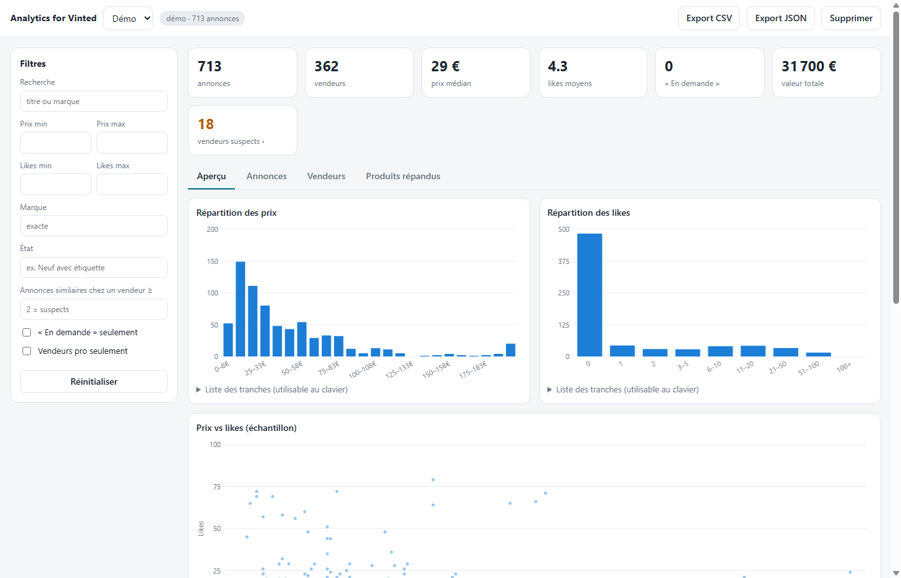
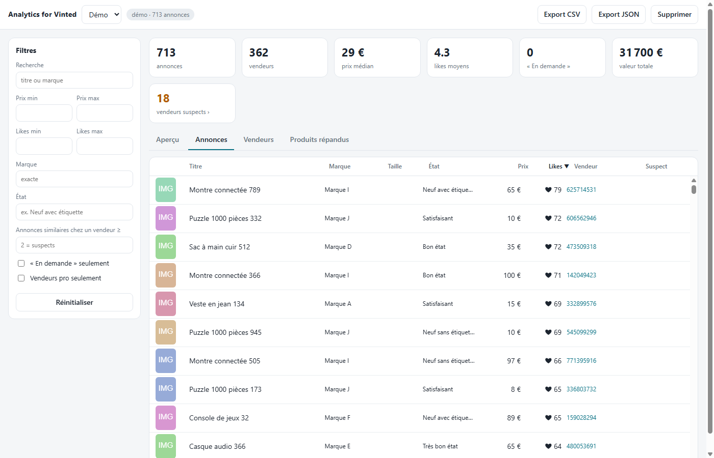
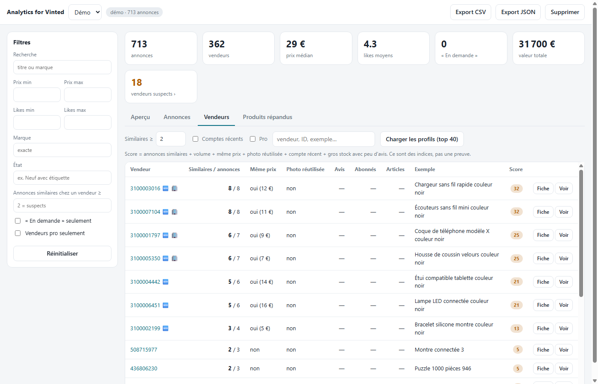
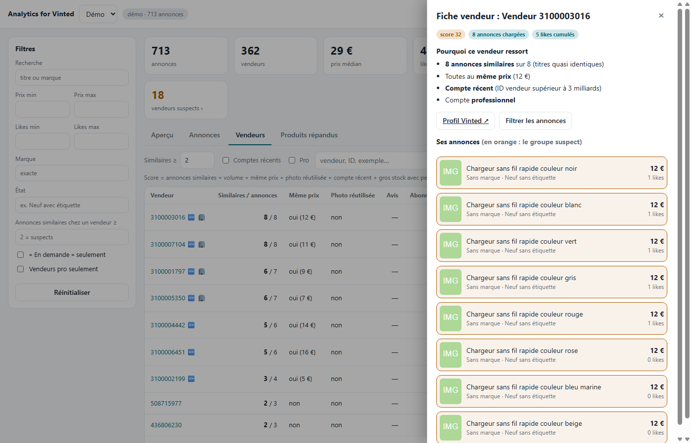

# Analytics for Vinted

Extension Chrome (Manifest V3) qui collecte les annonces d'une recherche vinted.fr et les analyse dans un
dashboard local : répartition des prix et des likes, filtres croisés, repérage des vendeurs qui revendent
massivement le même article.

> **Projet indépendant, non affilié à Vinted.** « Vinted » est une marque de ses propriétaires.
> Lis la section [Avertissements](#avertissements) avant utilisation.



*Captures réalisées avec des données 100 % fictives (voir [Développement](#développement)).*

## Fonctionnalités

- **Collecte rapide** : lit le JSON embarqué dans les pages (pas de scraping du DOM), 96 annonces par page,
  requêtes en parallèle avec ralentissement automatique si Vinted limite le débit.
- **Au-delà de la limite de 960 annonces** : Vinted plafonne chaque recherche à 10 pages. Le mode *MAX+* découpe
  la recherche par tranches de prix (dichotomie), puis par tris différents, et fusionne les résultats.
- **Dashboard** : indicateurs, graphiques (prix, likes, prix contre likes, marques, vendeurs, ancienneté des comptes),
  tableau virtualisé (fluide avec des dizaines de milliers de lignes), exports CSV et JSON.
- **Filtres** : prix, likes, marque, état, vendeur pro, « En demande » (expérimental), annonces similaires.
  Un clic sur une barre des graphiques filtre sur cette tranche.
- **Détection de revendeurs** : annonces quasi identiques chez un même vendeur, même prix, photo réutilisée,
  compte récent, gros stock avec peu d'avis. Fiche détaillée par vendeur.
- **Accessible** : navigation clavier, rôles ARIA (tableau, onglets, boîte de dialogue), alternative texte aux graphiques.

| Annonces | Vendeurs | Fiche vendeur |
|---|---|---|
|  |  |  |

## Installation

1. Télécharge ou clone ce dépôt.
2. Ouvre `chrome://extensions` et active le **mode développeur**.
3. **Charger l'extension non empaquetée** → choisis le dossier du dépôt.

## Utilisation

1. Ouvre une recherche ou une catégorie sur vinted.fr (avec tes filtres).
2. Dans le widget en bas à droite, choisis le volume puis **Analyser**.
3. Le dashboard s'ouvre et se remplit en direct. L'icône de l'extension le rouvre.

## Vie privée

- **Tout reste dans ton navigateur** (IndexedDB). Pas de serveur, pas de télémétrie, aucun envoi de données.
- L'extension n'agit que sur `https://www.vinted.fr/*` et ne demande qu'une permission (`unlimitedStorage`).
- Les données collectées contiennent des **identifiants et pseudos de vendeurs** : ce sont des données personnelles.
  Ne les publie pas, ne les partage pas, et supprime les sessions dont tu n'as plus besoin (bouton *Supprimer*).

## Avertissements

- **Conditions d'utilisation** : l'extraction automatisée peut être interdite par les conditions de Vinted.
  Tu es seul responsable de l'usage que tu en fais. Prévois un volume raisonnable : le mode MAX+ envoie
  beaucoup de requêtes et peut entraîner un blocage temporaire de ton accès.
- **Repérage de revendeurs** : le score est un **indice, pas une preuve**. Un vendeur qui vide ses placards peut
  ressortir. N'utilise pas cet outil pour harceler, dénoncer publiquement ou cibler des personnes.
- **Fragilité** : l'extension lit le JSON interne des pages Vinted, qui n'est pas une API officielle.
  Elle peut cesser de fonctionner à tout moment, sans garantie de maintenance.
- **Non testé en conditions réelles** : le chargement des profils vendeurs (avis, abonnés) et le filtre
  « En demande » (la mention n'apparaît pas pour un visiteur non connecté) ; les exports CSV/JSON.

## Architecture

```
src/content/parser.js          lit le JSON embarqué des pages (sans DOM)
src/content/crawler.js         widget, pool de requêtes adaptatif, découpe par prix, reprises
src/background/service-worker  stockage IndexedDB, profils vendeurs, ouverture du dashboard
src/lib/db.js                  couche IndexedDB
dashboard/                     page d'analyse : Web Worker (calcul), graphiques canvas, tableau virtualisé
tools/make-demo-data.ps1       génère le jeu de données fictif de démonstration
```

## Développement

Aucune dépendance, aucun build : ce sont des fichiers JavaScript, HTML et CSS bruts.

Mode démo du dashboard (hors extension, avec des données fictives) :

```bash
python -m http.server 8000      # depuis la racine du dépôt
# puis ouvre : http://localhost:8000/dashboard/dashboard.html?demo=/docs/demo-items.json
```

Régénérer les données fictives : `powershell -File tools/make-demo-data.ps1`.
Le paramètre `?demo=` est volontairement ignoré dans l'extension installée.

## Sécurité

Voir [SECURITY.md](SECURITY.md) pour le modèle de menace et le signalement des vulnérabilités.

## Licence

[MIT](LICENSE)

---

## English summary

**Analytics for Vinted** is an independent, unofficial Chrome extension (Manifest V3) that collects the listings of
a vinted.fr search and analyses them in a local dashboard: price/likes distributions, cross filters, and detection of
sellers who resell the same item many times. It reads the JSON embedded in the pages, works around Vinted's
10-page-per-search cap by splitting searches by price range, and stores everything locally in IndexedDB.
No server, no telemetry. Load it via `chrome://extensions` → Developer mode → *Load unpacked*.

**Not affiliated with Vinted.** Automated extraction may violate Vinted's terms of service; use responsibly and at
low volume. Seller identifiers are personal data: do not publish or share collected data. The seller score is a hint,
not proof. MIT licensed.
